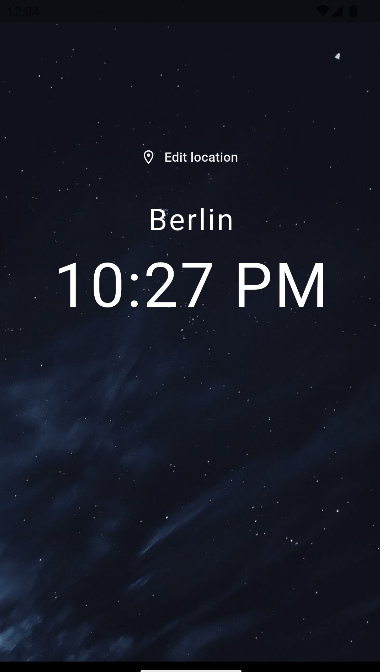
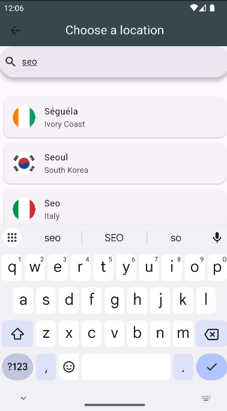
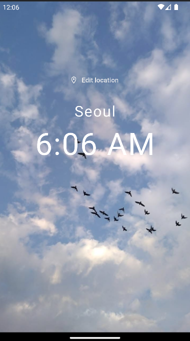

# World Time App

A Flutter app that shows the current time in any city in the world. Search for a city, tap it, and the home screen updates with the local time, the country flag, and a day or night background.

## Screenshots

<p align="center">
  
  
  
</p>


## Features

- Live city search with results as you type (debounced to avoid unnecessary requests)
- Current local time for the selected city
- Day and night themes with different background images
- Country flag shown for each location
- Loading screen with a spinner on startup
- Loading indicator and error message when a time request fails

## Tech stack

- Flutter and Dart
- [`http`](https://pub.dev/packages/http) for network requests
- [`intl`](https://pub.dev/packages/intl) for time formatting
- [`flutter_spinkit`](https://pub.dev/packages/flutter_spinkit) for the loading animation

## APIs used

- [Open-Meteo Geocoding API](https://open-meteo.com/en/docs/geocoding-api) to search cities and get their timezone and country code
- worldtime.timezone.io to get the current time for a timezone
- [Flagpedia (flagcdn.com)](https://flagpedia.net/) for country flag images

## Project structure

```
lib/
├── main.dart                  # App entry point and named routes
├── pages/
│   ├── loading.dart           # Splash screen, fetches the initial time
│   ├── home.dart              # Shows location, time, flag, day/night background
│   └── choose_location.dart   # City search and selection
└── services/
    └── world_time.dart        # WorldTime model and time API logic
assets/
├── day.jpg
└── night.jpg
```

## How it works

1. `Loading` creates a `WorldTime` object for a default city, fetches its time, then opens `Home` and passes the data as route arguments.
2. On `Home`, the **Edit location** button opens `ChooseLocation` and waits for a result.
3. In `ChooseLocation`, typing searches the geocoding API. Tapping a city fetches its time and returns the data to `Home` with `Navigator.pop`.
4. `Home` calls `setState` with the new data and rebuilds.

## Getting started

Make sure you have the [Flutter SDK](https://docs.flutter.dev/get-started/install) installed.

```bash
git clone https://github.com/yaraahmed-ab/world-time-app.git
cd world-time-app
flutter pub get
flutter run
```

## What I learned

- Navigating between screens with named routes and passing data in both directions
- Separating UI (`pages/`) from data and networking (`services/`)
- Working with async code and handling failed requests
- Debouncing user input to reduce API calls
- Chaining two APIs together

## Author

Yara Ahmed
